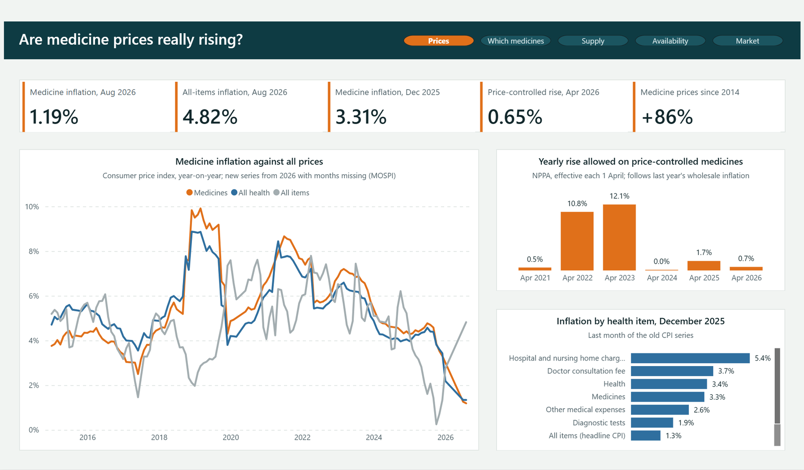
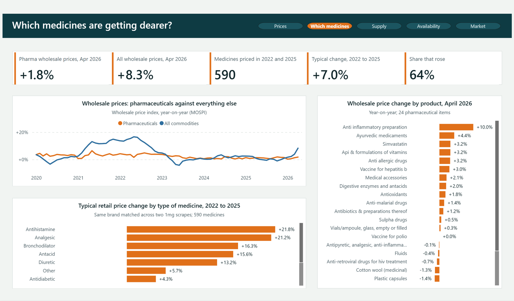
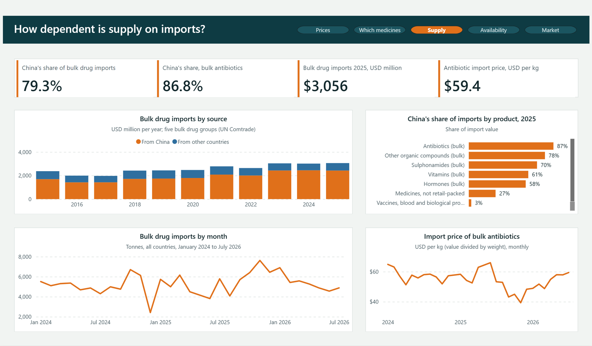
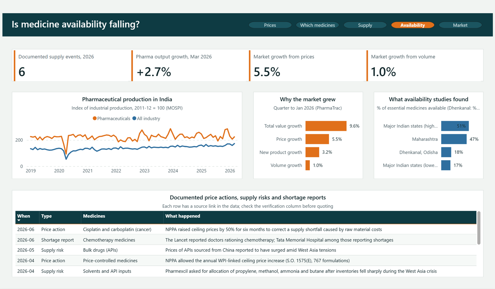
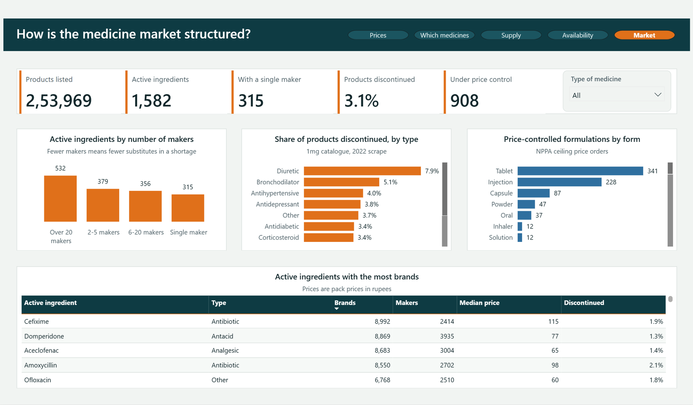

# 💊 Medicine Prices and Availability in India (2026 Analysis)

[](https://powerbi.microsoft.com/)
[](LICENSE)
[](#data-sources)

An analytical, multi-page **Power BI project** evaluating pharmaceutical pricing dynamics, supply chain vulnerabilities, and medicine availability across India.

This project investigates the common public hypothesis:
> *"Are medicine prices in India experiencing unprecedented price spikes, and is a nationwide availability crisis occurring in 2026?"*

By triangulating government price indexes (CPI & WPI), trade flows (UN Comtrade), statutory ceiling price revisions (NPPA), and retail market catalogues, this dashboard provides a data-grounded assessment of India's pharmaceutical ecosystem.

---

## 📌 Key Findings & Executive Summary

- **Price Trends vs. Inflation:** Over the decade since 2014, cumulative retail medicine prices have climbed **+86%**. However, contrary to sensational headlines, **medicine inflation moderated significantly into 2026** (falling from spikes of 10–12% in 2022–2023 down to **1.19% in August 2026**, well below overall consumer headline inflation of 4.82%).
- **Uneven Price Increases:** While broad indices appear tame, price rises are concentrated. Between 2022 and 2025, **64%** of tracked retail medicines grew in cost, with **antihistamines and pain relievers rising by ~21%**.
- **Supply Chain Vulnerability (API Dependency):** India relies heavily on foreign suppliers for critical Active Pharmaceutical Ingredients (APIs). In 2025, **China accounted for 79.3% of total bulk drug imports ($3.06 Billion)** and **86.8% of imported antibiotic raw materials**.
- **Availability Reality:** Overall domestic pharmaceutical production continues steady expansion (**+2.7% YoY**), dispelling claims of a universal market collapse. However, **acute shortages arose in specific critical care segments** (e.g., oncology/chemotherapy), prompting regulators to enact emergency 50% price ceiling increases to restore market supply.
- **Single-Source Vulnerabilities:** Among 1,582 active molecules in retail circulation, **315 molecules rely on only a single manufacturer**, posing severe risk to patient care if disruptions strike individual plants.

---

## 🖥️ Dashboard Overview & Report Pages

The Power BI report contains **5 dedicated analytical views**:

### 1. Prices — Are Medicine Prices Really Escalating?
Tracks long-term and monthly trends across Consumer Price Index (CPI), Wholesale Price Index (WPI), NPPA allowed price revisions, and hospital/healthcare service tariffs.



* **Core Takeaways:** Official medicine inflation cooled to **1.19% by August 2026**. Regulated price increases under the National List of Essential Medicines (NLEM) were capped at just **0.65% in April 2026**, compared to double-digit hikes in prior years. Hospital charges continue to outpace medicine costs.

---

### 2. Which Medicines — Identifying Outliers & Category Shifts
Analyzes 590 matched formulations between 2022 and 2025 alongside wholesale sub-indices to pinpoint which therapeutic categories experienced significant cost escalation.



* **Core Takeaways:** Medicine price changes are starkly non-uniform. The median change was **+7.0%** over three years, but everyday medications such as antihistamines and non-steroidal painkillers saw compounding increases exceeding **21%**.

---

### 3. Supply — Raw Material & API Import Dependence
Evaluates import dependencies, origin countries, and month-over-month bulk drug shipment volumes into Indian ports.



* **Core Takeaways:** India imports over **$3 Billion** worth of bulk pharmaceutical drugs annually. China supplies nearly **4 out of every 5 dollars** of imported raw drug materials and **86.8% of antibiotic bulk compounds**, highlighting a vital strategic dependency.

---

### 4. Availability — Production Volumes & Documented Shortages
Cross-examines pharmaceutical manufacturing growth indices against reported shortages, regulatory intervention notices, and clinical supply events.



* **Core Takeaways:** National production remains resilient. Documented stock shortages are localized to narrow high-dependency therapies, such as pediatric and oncology formulations, where price controls originally squeezed producer margins before emergency upward revisions.

---

### 5. Market — Industry Structure & Formulation Vulnerability
Categorizes 1,582 active pharmaceutical molecules by market competitiveness, monopoly status, and statutory price caps.



* **Core Takeaways:** **908 formulations** operate under NPPA ceiling price governance. Critically, **315 active molecules** possess zero brand substitutes—meaning any interruption at a single manufacturer immediately threatens patient access.

---

## 📂 Repository Structure

```text
├── dashboard/
│   ├── IndiaMedicinePrices.pbip            # Power BI Project definition file (PBIP)
│   ├── IndiaMedicinePrices.Report/         # Visual layout, theme, and report pages
│   └── IndiaMedicinePrices.SemanticModel/  # Data model schema, relationships, and DAX measures
├── data/                                   # 12 Raw & Cleaned CSV Datasets
│   ├── availability_studies.csv            # Empirical research findings on healthcare availability
│   ├── bulk_drug_imports_monthly.csv       # Monthly time-series of bulk drug imports
│   ├── consumer_price_inflation.csv        # MOSPI CPI series across health & medicine
│   ├── medicine_events.csv                 # Chronological log of shortage & regulatory events
│   ├── medicine_market_by_molecule.csv     # Formulation counts and manufacturer distributions
│   ├── medicine_price_change_2022_2025.csv # Matched product price changes over 3 years
│   ├── nppa_annual_price_revision.csv      # Annual maximum allowed increases for scheduled drugs
│   ├── nppa_ceiling_prices.csv             # Regulated ceiling price orders (DPCO)
│   ├── pharma_market_growth_2026.csv       # Market sales value vs. volume growth breakdown
│   ├── pharma_production_index.csv         # Index of Industrial Production (IIP) for pharma
│   ├── pharma_trade_annual.csv             # Annual UN Comtrade international exchange data
│   └── wholesale_price_index.csv           # WPI sub-indices for pharmaceutical products
├── screenshots/                            # High-resolution dashboard captures
│   ├── 1-prices.png
│   ├── 2-which-medicines.png
│   ├── 3-supply.png
│   ├── 4-availability.png
│   └── 5-market.png
└── README.md                               # Project documentation
```

---

## 🚀 How to Run the Dashboard Locally

### Prerequisites
* [Power BI Desktop](https://powerbi.microsoft.com/desktop/) (Version 2024 or newer recommended to support the modern `.pbip` project format).

### Step-by-Step Setup
1. **Clone the Repository:**
   ```bash
   git clone https://github.com/adithyan200418/india-medicine-prices-dashboard.git
   cd india-medicine-prices-dashboard
   ```

2. **Open the Project:**
   * Double-click `dashboard/IndiaMedicinePrices.pbip` to launch it directly in Power BI Desktop.

3. **Configure the Data Path Parameter:**
   * In Power BI Desktop, navigate to the top ribbon:
     **Home** &rarr; **Transform data** &rarr; **Edit parameters**
   * Update the `DataFolder` parameter value to the absolute path of your local `data` directory (e.g., `C:\Projects\india-medicine-prices-dashboard\data` with no trailing slash).
   * Click **OK**.

4. **Refresh Data:**
   * Click **Home** &rarr; **Refresh**.
   * All five dashboard pages will populate with the latest visualizations and metrics!

---

## 📊 Data Sources & Transparency

All data utilized in this repository is sourced from official and peer-reviewed channels:

| Source | Description / Usage | License / Attribution |
|---|---|---|
| [MOSPI Open Data](https://api.mospi.gov.in) | Consumer Price Index (CPI), Wholesale Price Index (WPI), Industrial Production (IIP) | Government of India Open Data |
| [UN Comtrade](https://comtradeplus.un.org) | International import/export flows for pharmaceuticals and bulk drugs | UN Comtrade Terms |
| [NPPA (Govt of India)](https://www.nppaindia.nic.in) | National Pharmaceutical Pricing Authority ceiling prices and revisions | Public Domain / CC0 |
| [Kaggle Pharma Datasets](https://www.kaggle.com) | Product catalogues, active molecules, and retail pharmacy price tracking | MIT / CC BY-NC-SA 4.0 |
| *The Lancet* & Health Journals | Shortage studies and documented clinical event logs | Academic citation |

---

## 👤 Author & Acknowledgments

* **Analysis & Visualization:** Created by [@adithyan200418](https://github.com/adithyan200418)
* Built using Microsoft Power BI Desktop (PBIP Format).
